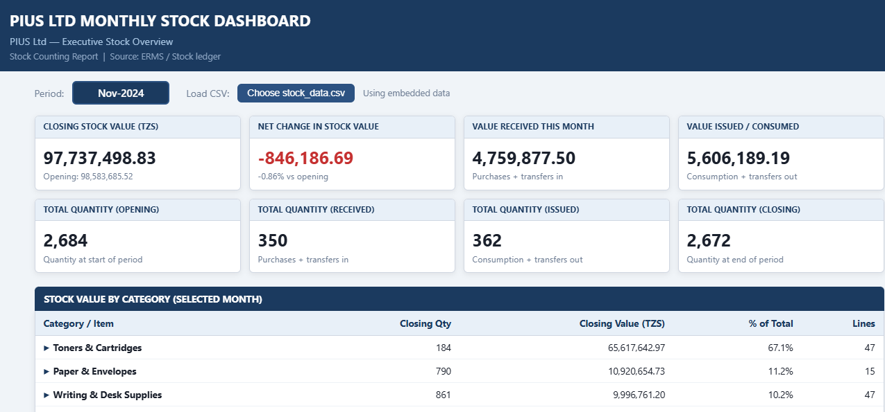

# PIUS Ltd Monthly Stock Dashboard

Interactive inventory dashboard that turns monthly stock-counting reports into clear KPIs, movement analysis, and slow/dead-stock alerts for faster decision-making.

Built for **PIUS Ltd** stock counting and inventory reporting. Works entirely offline in any modern browser — no server or installation required.

**Author:** Paison Tazvy



# PIUS Ltd Monthly Stock Dashboard

**Turning monthly stock-counting reports into actionable inventory insights**

---

### The Problem
Monthly stock-counting reports were available only as dense Excel ledgers.  
Managers struggled to quickly answer basic questions:

- What is the total value of stock on hand?
- How much moved in and out this period?
- Which items are slow-moving or at risk of becoming dead stock?
- Which items are completely out of stock?

Without a clear view, slow-moving inventory and stock-outs were hard to spot in time.

---

### The Solution
I designed and built a lightweight, interactive HTML dashboard that:

- Converts raw stock ledgers into clear **value and quantity KPIs**
- Shows **Opening → Received → Issued → Closing** movement at a glance
- Groups items into meaningful business categories with expandable drill-down
- Highlights a **Watchlist** of slow-moving, marked-for-disposal, and out-of-stock items
- Works completely offline and can be updated by non-technical users via a simple CSV

The dashboard is self-contained (no server required) and was built specifically for practical inventory reporting needs.

---

### Key Features
- Executive KPI cards (stock value, net change, receipts, issues)
- Total quantity tracking across the full stock movement cycle
- Expandable category analysis
- Automated watchlist for slow/dead / out-of-stock items
- Editable reporting period
- Easy data refresh via CSV

---

### Skills Demonstrated
- Business process understanding (inventory control & stock valuation)
- Translating operational pain points into clear metrics
- Data cleaning and structuring from complex Excel reports
- Front-end development (HTML, CSS, JavaScript)
- Designing usable tools for non-technical stakeholders
- Documentation and handover (including a Power BI rebuild guide)

---

### Impact
The dashboard gives management an immediate, visual overview of inventory health instead of requiring them to dig through multi-column Excel files.  
It supports faster identification of slow-moving stock and stock-outs — both of which affect working capital and service levels.

---

**Author:** Paison Tazvy  
**Organisation context:** Built for PIUS Ltd inventory reporting needs

## How to Use

### View the dashboard
1. Download or clone this repository
2. Open `index.html` in Chrome, Edge, or Firefox (double-click the file)

### Update with new monthly data
1. Prepare a CSV file with these columns:

```
sn,description,unit,opening_qty,opening_unit_price,opening_value,received_qty,received_unit_price,received_value,issued_qty,issued_unit_price,issued_value,closing_qty,closing_unit_price,closing_value,status
```

2. Open the dashboard → click **Choose stock_data.csv** → select your new file
3. Update the **Period** field at the top (e.g. `Dec-2024`)

A sample file `stock_data.csv` is included.

## Project Structure

```
pius-stock-dashboard/
├── index.html          # Main dashboard (self-contained)
├── stock_data.csv      # Sample data
├── LICENSE
└── README.md
```

## Technical Notes

- Pure HTML + CSS + JavaScript (no frameworks)
- Data can be embedded or loaded from CSV
- Category grouping is automatic based on item description keywords
- Designed for internal reporting use

## Author

**Paison Tazvy**

## License

MIT License — feel free to use and adapt.
